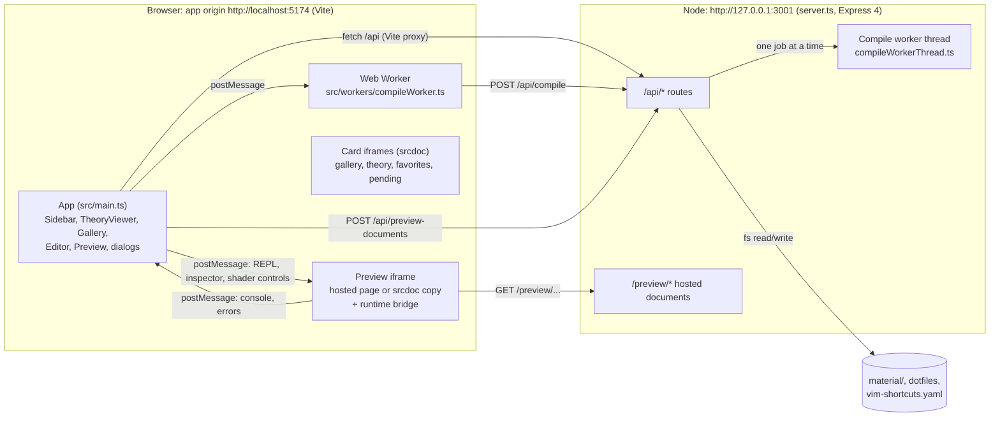
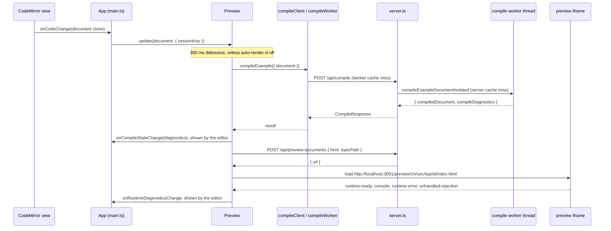

# LearnWeb architecture

LearnWeb is a local app for learning web development. The course lives on disk as Markdown under
`material/`; the app shows the theory of a topic, a gallery of its runnable examples, an editor for each
example and a live preview with a Chrome-like console. There is no database and no build step for the
server: a Vite app in the browser talks to a small Express server that reads and writes the repository.

This document is the map: the pieces, the data model, the main flows end to end, the security model of the
previews and a module map. How to run, test and extend the code is in [DEVELOPMENT.md](DEVELOPMENT.md).
File formats for authors are in `skills/learnweb-example-authoring/SKILL.md`,
`skills/learnweb-theory-authoring/SKILL.md` and `skills/learnweb-shader-authoring/SKILL.md`.

## Contents

- [1. The pieces](#1-the-pieces)
- [2. Content on disk](#2-content-on-disk)
- [3. Data model](#3-data-model)
- [4. Flows](#4-flows)
  - [4.1 Startup and the material tree](#41-startup-and-the-material-tree)
  - [4.2 Opening a topic: theory and example embeds](#42-opening-a-topic-theory-and-example-embeds)
  - [4.3 Opening an example: parse, document model, editor panels](#43-opening-an-example-parse-document-model-editor-panels)
  - [4.4 Editing, compiling, rendering, preview, console](#44-editing-compiling-rendering-preview-console)
  - [4.5 Saving](#45-saving)
  - [4.6 Shaders](#46-shaders)
  - [4.7 Exercises](#47-exercises)
  - [4.8 Gallery cards and other card previews](#48-gallery-cards-and-other-card-previews)
  - [4.9 Smaller flows](#49-smaller-flows)
- [5. Security model of the previews](#5-security-model-of-the-previews)
- [6. Module map](#6-module-map)

## 1. The pieces



| Piece | Where it runs | Entry point | What it does |
|---|---|---|---|
| Browser app | Vite dev server, `http://localhost:5174` (`vite.config.ts`) | `index.html` → `src/main.ts` | The whole UI. One `App` object wires the components together. |
| API server | Node, `127.0.0.1:3001` (`LEARNWEB_API_HOST` overrides the host) | `server.ts` | Reads and writes `material/` and the dotfiles, compiles examples, hosts rendered previews. Vite proxies `/api` to it (`vite.config.ts`), so the app calls it same-origin. |
| Compile worker (browser) | Web Worker started by `src/utils/compileClient.ts` | `src/workers/compileWorker.ts` | Caches and de-duplicates compile requests before they reach the server. |
| Compile worker thread (server) | `worker_threads` worker with memory and time limits | `src/utils/compiler/compileWorkerThread.ts`, managed by `isolatedCompiler.ts` | Runs Pug, Sass, TypeScript, esbuild and the Vue compiler, so an endless Sass `@while` cannot take the API down. |
| Preview iframe | `#preview-frame` in `index.html` | a document built by `src/utils/renderer/documentRenderer.ts` or `shaderRenderer.ts` | Runs the learner's page. The runtime bridge (`runtimeBridgeRuntime.ts`) is injected first and reports console output and errors to the app. |
| Card iframes | inside gallery cards, theory panels and dialogs | the same renderers, as `srcdoc` | Small, sandboxed, console-less copies of examples. |
| Material on disk | the repository | `material/**`, `.favorites`, `.pending`, `.hiddens`, `.vim_enable`, `.clipboard_default`, `vim-shortcuts.yaml` | The course and the user's state. Nothing else is persisted on the server. |

Several modules run in more than one place, which constrains what they may import:

| Code | Runs in | Constraint |
|---|---|---|
| `src/utils/markdown/`, `src/utils/compiler/`, `src/utils/exampleCompiler.ts`, `src/utils/compileCache.ts`, `src/utils/materialTree.ts`, the stores (`favoritesStore.ts`, `pendingStore.ts`, `editorDefaults.ts`), `src/editor/vimShortcutConfig.ts` + `vim/yamlParser.ts`, `src/utils/demoApi.ts` | Node (server, scripts, tests) | No DOM access. The markdown model also runs in the browser. |
| `src/utils/renderer/*`, `theoryRenderer.ts`, `theoryExerciseEmbeds.ts`, `compiledStyleView.ts`, `shaderPreviewDiagnostics.ts` | Browser, and Node in `scripts/snapshot-material.ts` and the tests | Importable under Node: DOM access only inside functions, behind `typeof window` / `typeof document` checks where needed. |
| `src/utils/api.ts` | Browser main thread and the compile Web Worker | No DOM access. |
| `learncodeRuntimeBridge` in `src/utils/renderer/runtimeBridgeRuntime.ts` | Inside the preview iframe | Serialized with `Function.prototype.toString()` and evaluated in the iframe: it must stay self-contained (only type imports, no outside references). |

## 2. Content on disk

```txt
material/
  chNN-slug/                 chapter (label.txt: optional display name, first non-empty line)
    secNN-slug/              section (label.txt likewise)
      topNN-slug/            topic
        main.md              theory; its first "# " heading is the topic's label
        examples/*.md        runnable examples (README.md is ignored)
        assets/**            images, data, modules, textures; subfolders allowed
```

- Folder names must start with `ch`, `sec`, `top`; the number orders them (`buildMaterialTree` in
  `src/utils/materialTree.ts`, natural order: `top9` before `top10`). Labels come from `label.txt`
  (chapters, sections) or the first `# ` heading of `main.md` (topics, read from the first 2 KB, fenced code
  ignored), falling back to the slug with dashes turned into spaces.
- An example is fenced code blocks (`# HTML` + ```` ```html ````, …) or, for React/Vue projects,
  `## @file` / `## @lang` / `## @role` sections; both can start with a `key: value` frontmatter. The full
  format is in `skills/learnweb-example-authoring/SKILL.md`; tracked samples of every format live in
  `material/ch00-tests/` and `material/ch01-templates/` (the course itself, `material/ch02+`, is not part of
  this repository's history).
- `main.md` is Markdown rendered with `marked`, plus shortcodes on their own line:
  `[[exercise:file.md]]` (a card with a live preview), `[[exercise:file.md-]]` (the example's code in tabs),
  `[[exercise:file.md-name]]` / `[[exercise:file.md-(a|b)]]` (only some files), and links
  `[text](NN-x.md)` that open an example's preview (`src/utils/theoryExerciseEmbeds.ts`,
  `src/utils/theoryRenderer.ts`).
- Root dotfiles hold the user's state, all edited through the API and tolerant of hand edits:
  `.favorites` and `.pending` (JSON lists of `material/.../examples/x.md` paths), `.hiddens` (hidden
  chapters), `.vim_enable` and `.clipboard_default` (one-line flags, on when missing), and
  `vim-shortcuts.yaml` (Vim shortcut overrides).

Browser-only preferences live in `localStorage` under `learncode.*` keys: the saved session
(`learncode.session`: topic, open file, editor layout, preview sizes and zoom), sidebar width and collapse,
editor layout/Vim/clipboard/column guide, preview auto-render, gallery overlay visibility and "show hidden
chapters". They are read in `src/main.ts`, `src/components/Sidebar.ts`, `Gallery.ts`, `Preview.ts` and
`src/components/editor/sessionManager.ts`.

## 3. Data model

Shared shapes are declared in `src/types/` (types only, no runtime code). One file per contract:

| File | Contract |
|---|---|
| `src/types/document.ts` | The example document model (`ExampleDocument`, `ExampleBlock`, `VirtualFile`, `ExampleMetadata`) and its derived views (`ExerciseConfig`, `ShaderConfig`, `ExampleEditorialMetadata`, file visibility, file-type changes, mutation inputs, session presets, line highlights). The closed sets (block types, slots, languages, stages…) are derived from the runtime tables in `src/config/exampleBlocks.ts`, `src/utils/markdown/constants.ts` and `src/config/highlightColors.ts`. |
| `src/types/diagnostics.ts` | `Diagnostic`: the one shape shared by structural (parse/validation), compile and runtime problems. |
| `src/types/compile.ts` | The compile contract: `CompileSourceDocument` in, `CompileResult` (`CompiledDocument` + diagnostics) out, and the `POST /api/compile` payloads. |
| `src/types/runtime.ts` | The protocol between a preview iframe and the app: `RuntimeBridgeConfig`, every `postMessage` payload in both directions, remote values of the object inspector. |
| `src/types/api.ts` | Request and response bodies of every JSON route of `server.ts`, as `src/utils/api.ts` returns them. |
| `src/types/material.ts` | The material tree (`MaterialChapter` > `MaterialSection` > `MaterialTopic`) and the raw/normalized shapes of `.hiddens`, `.favorites`, `.pending`. |
| `src/types/theory.ts` | Theory pages: the editor's theory pseudo-document (`TheoryDocument`), the exercise/code embeds built from `[[exercise:…]]` shortcodes, and the options of the theory render functions. |
| `src/types/utility.ts` | Small type-level helpers (`DistributiveOmit`). |

### The example document

`parseExampleDocument(text)` (`src/utils/markdown/documentApi.ts`) turns an example file into an
`ExampleDocument`, and every document function returns a new one (documents are treated as immutable):

| Field | Meaning |
|---|---|
| `sourceFormat` | `'legacy-blocks'` (fenced blocks: `blocks` is the source of truth and `files` is derived, one file per block, with fixed paths such as `index.html`, `styles.css`, `script.js`) or `'virtual-files'` (`## @file` sections: `files` is the source of truth, `blocks` is empty). |
| `metadata` | The frontmatter after `normalizeMetadata()` (`src/utils/markdown/core.ts`): known keys lower-cased and normalized, unknown keys kept verbatim, empty values dropped. |
| `blocks` | Legacy blocks `{ id, slot, type, language, heading, content }`, sorted by slot (`app`, `markup`, `style`, `script`, `vertex`, `fragment`; `SLOT_ORDER` in `src/config/exampleBlocks.ts`). |
| `files` | What the editor shows: `{ id, path, name, language, role, content, sourceKind, … }`. The editor addresses files by `id` (`${path}:${order}`). |
| `rendererMode` | `'shader'` for a legacy document with `renderer: shader` or vertex/fragment blocks, else `'web'` (`inferRendererMode` in `documentMeta.ts`). |
| `sessionId` | A shape descriptor (`html-css-javascript`, `react-multi-file`…). |
| `diagnostics` | Structural problems found while parsing and validating (`validationMetadata.ts`, `validationDocuments.ts`). A diagnostic with `level: 'error'` makes the document "blocking": it cannot be saved (`hasBlockingDiagnostics`). |
| `unsupportedBlocks` | Fenced blocks in a language the parser does not know. Each comes with an error diagnostic, which also prevents saving (serialization writes only `blocks`, so they would be lost). |

`synchronizeDocument()` recomputes the derived fields (legacy `files`, `rendererMode`, `sessionId`) and
copies edited legacy file contents back into their blocks. Typing only updates content
(`updateDocumentFileContent`, no re-validation); structural edits in `src/utils/markdown/mutations.ts`
(add/remove/rename a file, change its type, edit editorial or shader metadata) serialize the document and
parse it again, so their diagnostics are always fresh. `buildExampleDocument()` serializes a document back
to Markdown (frontmatter keys sorted alphabetically, legacy blocks in slot order with their canonical
headings, fences long enough for their content).

The theory file is edited through a look-alike: `createTheoryDocument()` (`src/utils/theoryDocument.ts`)
builds a `TheoryDocument` (`src/types/theory.ts`) with one file, `main.md` (language `markdown`,
`sourceKind: 'theory'`), and `metadata.editorTarget: 'theory'`. It has the shape of an example document so
the editor's plumbing (files, tabs, dirty tracking, snapshots) works on it unchanged; `isTheoryDocument()`
tells them apart.

### Compile results and diagnostics

`compileExampleDocument()` (`src/utils/exampleCompiler.ts`) returns `{ compiledDocument, compileDiagnostics }`.
`CompiledDocument` always has `html`, `css` and `js`; plain examples add `markupType`, `lang`,
`runtimeScriptPath` and `jsView` (TypeScript output as `tsc` would print it), HTML-FULL examples only carry
`fullDocumentHtml`, React/Vue examples set `framework` and put an IIFE bundle in `js`. Source maps travel
inline in `js`. The server wraps the result in a `CompileResponse` with `document` and
`compileMeta: { cacheKey, cacheStatus }`.

Every diagnostic has `level` (`error`, `warning`, `info`), a stable `code` and a `message`, plus optional
location fields (`file`/`path`, `line`, `column`, `slot`). `blocking: false` (TypeScript type errors, Sass
warnings and deprecations) means "list it in the editor but still run the page".

## 4. Flows

### 4.1 Startup and the material tree

1. `index.html` loads `src/main.ts`; on `DOMContentLoaded` it creates `App`. The constructor builds every
   component (`Preview`, `ExercisePanel`, `Editor`, `Gallery`, `FavoritesDialog`, `PendingDialog`,
   `TheoryExerciseDialog`, `AssetsDialog`, `TheoryViewer`, `Sidebar`, `CreateDialog`) and passes each one
   callbacks into the others. No component class imports or holds another; `App` is the only wiring (they
   share helpers such as `editor/toast.ts`, and `TheoryExerciseDialog` borrows the console-rendering methods
   of `preview/ConsoleManager.ts`).
2. `App._bootstrap()` reads the saved session from `localStorage` first (persistence stays off until it is
   restored), then, in order: `Sidebar.load()` (`GET /api/tree?includeHidden=1`), the clipboard and Vim
   defaults (`GET /api/editor/clipboard-default`, `/api/editor/vim-default`), the Vim shortcut table
   (`GET /api/editor/vim-shortcuts`, a toast if `vim-shortcuts.yaml` was rejected), favorites and pending
   (`GET /api/favorites`, `/api/pending`), and finally `_restoreSessionState()`.
3. On the server, `GET /api/tree` calls `buildMaterialTree(MATERIAL_DIR, { hiddenStateFile, includeHidden })`
   (`src/utils/materialTree.ts`): it lists the `ch*`/`sec*`/`top*` folders, reads the labels and flags the
   chapters listed in `.hiddens`. The sidebar always fetches hidden chapters too and filters them itself, so
   topic lookups (session restore, favorites, create) find every topic.
4. `_restoreSessionState()` reopens the saved topic (`selectTopic`), then either the theory editor or the
   saved example (`loadExample`), and restores the editor layout and panel state. If no topic was restored
   and there are pending examples, `_showPendingOnStartup()` shows them in the gallery.

### 4.2 Opening a topic: theory and example embeds

`Sidebar` → `App.selectTopic(topicPath)`:

1. Guards unsaved work (`_confirmDiscardUnsavedChanges`), then gives the topic to `Editor.setTopicPath`,
   `Preview.setTopicPath` and the gallery, and shows the gallery (`App.showGallery`, which also clears the
   preview).
2. `TheoryViewer.load(topicPath)` fetches `main.md` (`fetchTopicMain`, `GET /api/topic/:ch/:sec/:top/main`;
   a missing file gives empty content) and calls `renderContent`:
   - `loadTheoryExerciseEmbeds(topicPath, content)` (`src/utils/theoryExerciseEmbeds.ts`) finds the
     `[[exercise:…]]` shortcodes outside code fences and, for each referenced example, fetches it, parses it,
     compiles it (`compileExample`) and renders a preview document (`renderCompiledExampleDocument`, or
     `renderShaderExampleDocument` paused on a still frame). It also collects the example's files for code
     embeds, adding the generated `compiled.css` / `sass-output.txt` / `compiled.js` tabs
     (`src/utils/compiledStyleView.ts`). A missing example becomes a "missing" card.
   - `renderTheoryHtml(content, { exerciseEmbeds, topicPath })` (`src/utils/theoryRenderer.ts`) replaces each
     shortcode by a placeholder comment, runs `marked` (GFM, `breaks: true`) with a custom renderer
     (highlight.js code blocks, raw HTML sanitized to a short allow-list, asset links resolved to
     `/api/topic/.../assets/...`, `[text](NN-x.md)` turned into preview links), then swaps the embed HTML back
     in.
   - The HTML goes into `#theory-content` in the app's own DOM. `_hydrateExercisePreviewSlots` then creates
     one `<iframe sandbox="allow-scripts">` per card with the prepared `srcdoc`, and `_hydrateCodeEmbedTabs`
     wires the code-embed tabs.
3. Clicks inside the theory panel are handled by `TheoryViewer`: "Preview", a card click, "▶ Run" or an
   example link call `App._openTheoryExercisePreview` → `TheoryExerciseDialog.open()`; "Open Exercise" /
   "Open in editor" call `App._openTheoryExercise`, which switches topic if needed and loads the example.
4. `TheoryExerciseDialog.open()` fetches, parses and compiles the example, publishes it as a hosted preview
   with the console on (`publishPreviewDocument`), falls back to a `srcdoc` copy after 4 s without a
   `runtime-ready` message, and lists console output and TypeScript type errors (`typescript-type`
   diagnostics) under the frame, reusing the console value rendering of `ConsoleManager`.
5. In parallel `Gallery.load(topicPath)` builds the example cards (see 4.8).

The theory editor uses the same pieces: `App.openTheoryEditor()` loads `main.md` into the editor as a theory
document (`Editor.loadTheoryDocument`), and `Preview` renders it with `renderTheoryPreviewDocument()` as a
standalone `srcdoc` page whose own script posts `learncode-theory-preview` messages (`open-exercise`,
`preview-exercise`) back to `Preview._handleRuntimeMessage`. While theory is being edited, `App` re-renders
the side panel 700 ms after the last edit (`_scheduleTheoryViewerRender`), only while the panel is visible and
auto-render is on; a stale panel is rendered when it is shown again.

### 4.3 Opening an example: parse, document model, editor panels

Gallery card click → `App._openExampleFromGallery(filename)` → `App.loadExample(filename)` →
`Editor.loadExample(filename)` (`src/components/editor/fileOperations.ts`):

1. `fetchExample(topicPath, filename)` (`GET /api/topic/:ch/:sec/:top/examples/:file`). A slower response for
   an older click is ignored (`_exampleLoadRequestId`).
2. `parseExampleDocument(content)`:
   - `parseFrontmatter` reads `key: value` lines (`parseMetadataValue`: booleans, canonical numbers, quoted
     strings) and `normalizeMetadata` normalizes them;
   - the first non-blank line after the frontmatter decides the format: `## @file` → `parseVirtualFiles`,
     otherwise `parseLegacyBlocks` (headings + fences; fence languages normalized through `BLOCK_ALIASES`,
     unknown languages reported as `unsupported-language`);
   - `validateMetadata` and `validateLegacyDocument` / `validateVirtualDocument` (plus hidden-file and
     exercise checks) push diagnostics;
   - `synchronizeDocument` fills the derived fields.
3. `Editor._applyDocument(document, { reset: true })` clones and synchronizes it, loads line highlights from
   the `highlights` metadata, derives the exercise config (`_syncExerciseConfig`), picks the active file,
   renders the workspace and notifies the preview (`_triggerChange`).
4. `Editor._renderWorkspace()` draws either Panels (all visible files stacked, resizable, collapsible) or Tabs
   (one file at a time). Visible files exclude those hidden through `editor_hidden_files` and the exercise's
   unrevealed reference/solution files (`_getVisibleFiles`). Each file gets a CodeMirror view from
   `_createEditor(container, file)`: language support by file language (`_getLanguageExtensions`: HTML, CSS,
   JavaScript/TypeScript/JSX/TSX, JSON, Vue, GLSL), learning completions, Vim (`createVimExtension` +
   `bindVimView`) when enabled, read-only for locked exercise files, and an update listener that feeds every
   change back into the document.
5. `_markDocumentSaved()` records the saved signature (the serialized document) for dirty tracking;
   `_loadExerciseComparisonSource()` fetches the linked solution example when there is one.

### 4.4 Editing, compiling, rendering, preview, console



1. **Change.** The CodeMirror update listener in `Editor._createEditor` calls `_setFileContent`
   (`updateDocumentFileContent`), refreshes the status and diagnostics, and `_triggerChange()` sends a clone
   of the document to `App`'s `onCodeChange`, which updates the exercise panel and calls
   `Preview.update(document, { sessionKey })`. The session key (`App._getPreviewSessionKey`:
   `topicPath::filename`, or the document's `sessionId` / `draft` for an unsaved one) keys the console history
   and the shader control state.
2. **Scheduling.** `Preview._scheduleRender` prepares the console session (the console is on when the example
   says `console: true`, when it has a script but no markup, or when the user forces it) and debounces 300 ms.
   With auto-render off nothing happens until Refresh (`renderNow`). Renders triggered by typing run with
   `suppressDialogs` (alert/confirm/prompt become console notices); opening an example or Refresh run them
   for real.
3. **Render dispatch** (`Preview._render`, each render gets a new `renderToken`): theory documents and shader
   documents render locally (4.2, 4.6); everything else is compiled.
4. **Compile, three caches.** `compileExample()` (`src/utils/compileClient.ts`) posts the request to the Web
   Worker (`src/workers/compileWorker.ts`), which keeps an 80-entry LRU cache and merges identical in-flight
   requests, keyed by `createCompileCacheKey()` (`src/utils/compileCache.ts`: stable serialization of the
   document + two 53-bit hashes). On a miss it calls `requestCompileExample()` → `POST /api/compile`. The
   server keeps its own 120-entry LRU cache with the same key, and on a miss calls
   `compileExampleDocumentIsolated()` (`src/utils/compiler/isolatedCompiler.ts`): a queue that runs one job
   at a time in a worker thread capped at 384 MB old-generation memory and 5 s per job; a timeout or crash
   kills the thread and returns a `compile-timeout` / `compile-out-of-memory` / `compile-worker-crashed`
   diagnostic. If the Web Worker cannot start or fails, `compileClient` calls the API directly.
5. **Compilers** (`compileExampleDocument`, in the worker thread): React → `reactCompiler.ts` (esbuild bundle
   with React, single-file or multi-file through `virtualFilesPlugin.ts`), Vue → `vueCompiler.ts`
   (`@vue/compiler-dom` / `@vue/compiler-sfc` + esbuild), otherwise the markup (`markupCompiler.ts`: HTML/SVG
   as is, Pug, HTML-FULL), style (`styleCompiler.ts`: CSS as is, Sass with `@debug`/`@warn`/deprecation
   messages) and script (`scriptCompiler.ts`: V8/TypeScript syntax check in `syntaxCheck.ts`, TypeScript
   transpile + type check in `typeChecker.ts`) compilers. Loop guards (`loopGuard.ts`) are inserted in
   scripts and inline `<script>` tags unless the frontmatter says `loop_protect: false`; `typecheck: false`
   skips type checking.
6. **Diagnostics to the editor.** `Preview._emitCompileState` → `App` → `Editor.setCompileDiagnostics`, shown
   as gutter marks and in the status list (`src/components/editor/diagnostics.ts`). Sass examples also get the
   «CSS» panel with the generated CSS (`buildCompiledStyleFiles`).
7. **Render.** `renderCompiledExampleDocument(compiledDocument, topicPath, diagnostics, options)`
   (`src/utils/renderer/documentRenderer.ts`) builds a complete HTML page: `<html lang>`, the one-line runtime
   bridge `<script>` first in `<head>` (`buildRuntimeBridgeMarkupWithPlaceholder`), base styles only for
   SVG/React/Vue, the CSS, the markup, a «Compile diagnostics» box (when there are blocking errors, or any
   diagnostic while the console is off; `blocking: false` diagnostics never appear there), and the script
   (classic or module, `scriptKind.ts`). While building it records where each editor file starts and ends
   (`SourceRange`s) and the inline source map's line map (`sourceMap.ts`), and writes them into the bridge
   configuration so errors can be mapped back to editor lines. HTML-FULL documents are kept as written; the
   bridge (and `<base>` for srcdoc) is inserted without new lines right after `<meta charset>`, `<head>`,
   `<html>` or the doctype (`findInsertionPoint`), so line numbers do not move.
8. **Hosted or srcdoc.** `Preview` renders the document with `hosted: true` and uploads it with
   `publishPreviewDocument()` (`src/utils/renderer/previewHost.ts`) to `POST /api/preview-documents`, which
   keeps the last 24 documents in memory and returns `/preview/<ch>/<sec>/<top>/<id>/index.html`. The client
   turns it into a URL on port 3001 with the app's hostname, and `Preview._showHosted` switches the iframe
   sandbox to `HOSTED_PREVIEW_SANDBOX` and navigates it there (`location.replace`). If the upload fails, the
   page is not cross-origin, or no `runtime-ready` arrives within 4 s, `Preview` renders the srcdoc variant
   and shows it instead (`_showSrcdoc`, sandbox without `allow-same-origin`, `<base href>` pointing at the
   topic assets), and skips hosting for 15 s. The «Open preview in a new tab» button (`#btn-open-preview-tab`) opens the hosted page on its own.
9. **Runtime bridge.** In the iframe, `learncodeRuntimeBridge(config)` runs before any learner code: it
   patches `console.*`, listens for errors and rejections, maps stack frames back to editor files through the
   ranges and line maps, logs blocked form submissions, shims storage/cookies/anchors/workers for srcdoc
   copies, defines the loop guard used by inline scripts, and posts `runtime-ready`. Every message carries
   `source: 'learncode-preview'` and the `renderId`.
10. **Back in the app.** `Preview._handleRuntimeMessage` drops messages whose `event.source` is not the
    preview iframe or whose `renderId` is stale, then: `runtime-ready` clears the hosted watchdog; errors and
    `console.error` become runtime diagnostics (`RuntimeDiagnostics.ts` → `Editor.setRuntimeDiagnostics`;
    syntax errors already reported by the compiler are skipped); console messages go to `ConsoleManager`
    (`_appendConsoleEntry`, batched rendering, at most 1000 entries).
11. **Console commands.** The REPL (`ConsoleManager._executeConsoleCommand`) and the object inspector
    (`_requestConsoleInspect`) post `learncode-console-command` messages (`eval`, `inspect`, `get-property`)
    to the iframe; the bridge answers with `command-result`, `command-error` or `inspect-result`. User values
    never cross the boundary: the bridge sends previews plus numeric handles, and the app asks for
    properties lazily. The full protocol is `src/types/runtime.ts`.

### 4.5 Saving

| Action | Trigger | Path |
|---|---|---|
| Modify (overwrite) | Modify button, Ctrl/Cmd+S, `:w` when a file is open, the metadata dialog's Apply | `Editor._handleModify()` → `modifyExample()` → `PATCH /api/topic/:ch/:sec/:top/examples/:file` |
| Save (new file) | Save button, `:w` when no file is open yet | `Editor._handleSave()` → `saveExample()` → `POST /api/topic/:ch/:sec/:top/examples`; the server names the file `mon-DD-YYYY-HH:MM:SS.md` |
| Theory | the same triggers while editing `main.md`, and closing the theory editor | `_handleModifyTheory()` → `modifyTopicMain()` → `PATCH /api/topic/:ch/:sec/:top/main` |
| Rename | click on the file name in the preview header | `renameExample()` → `PUT .../examples/:file` (409 if the target exists) |
| Delete | Remove button or the gallery card's trash icon | `removeExample()` → `DELETE .../examples/:file` |

Before writing, `_getPersistableDocument()` (`src/components/editor/theoryEditor.ts`) takes the current
document, stores the shader resolution chosen in the preview (`updateShaderResolution`) and the live line
highlights (`_injectHighlightsIntoDocument` → `highlights` metadata), and `buildExampleDocument()`
serializes it (`buildFrontmatter` + `buildLegacyMarkdown` or `buildVirtualMarkdown` in
`src/utils/markdown/parsers.ts`). Saving is refused while the document has blocking (error) diagnostics.
After a successful write `_commitPersistedDocument` marks it saved (edits typed during the request are kept).
After Save, Rename and Delete, `onExampleListChanged` lets `App` refresh favorites, pending and the gallery.

On the server every path is resolved through `resolveTopicDir` / `resolveExampleFile` (only plain `.md`
names inside the topic's `examples/`); delete and rename also update `.favorites` and `.pending`
(`forgetExampleReferences`). The dirty indicator compares the serialized current document with the saved
signature (`sessionManager.ts`, checked 250 ms after edits); `App` asks before leaving a dirty document and
on `beforeunload`.

### 4.6 Shaders

- **Model.** A legacy document is a shader when it says `renderer: shader` or has `vertex`/`fragment` blocks.
  Validation (`validateShaderLegacyDocument`) requires exactly one of each, nothing else, and a
  `resolution: WxH`. `shader_uniforms` (`name:type=value[min,max,step]|…`) and `shader_textures`
  (`uniform=asset-file|…`, top-level files of the topic's `assets/`) are parsed by
  `src/utils/markdown/shader.ts`; `getShaderConfig()` returns the parsed view.
- **No server compile.** `Preview._render` validates the GLSL in the app with a hidden WebGL context
  (`validateShaderPreviewDocument` in `src/utils/shaderPreviewDiagnostics.ts`, which turns the driver's log
  into diagnostics) and renders `renderShaderExampleDocument()` (`src/utils/renderer/shaderRenderer.ts`) as
  a srcdoc page: a canvas, a fullscreen quad, the built-in uniforms (`u_time`, `u_delta`, `u_resolution`,
  `u_mouse`, `u_mouse_pressed`, `u_frame`), the custom uniforms and the textures (fetched with CORS from
  `/api/topic/.../assets/`). The page starts paused.
- **Controls.** The page posts `shader-stats` (FPS, frame, resolution, uniform values, texture states, at most
  every 120 ms) and `shader-resize-request` on the `learncode-preview` channel. The shader panel
  (`src/components/preview/ShaderControls.ts`) shows them and sends `learncode-shader-control` commands
  (`set-resolution`, `set-paused`, `reset-runtime`, `set-custom-uniform`) back without re-rendering.
- **Editing metadata.** The Shader Uniforms and Shader Textures dialogs (`src/components/editor/shaderDialogs.ts`,
  textures picked from `fetchTopicAssets`) rewrite the metadata through `updateShaderUniformDefinitions` /
  `updateShaderTextureDefinitions`; the resolution chosen in the preview is written back on save.
- **Editor.** Vertex/fragment files get GLSL highlighting and completions (`src/editor/glslLanguage.ts`);
  shader-only Vim shortcuts live in the `shaders` context of `vim-shortcuts.yaml`.
- **Cards.** Gallery, theory and dialog cards render shaders paused on a single still frame
  (`shaderControls: { paused: true, stillFrame: true }`).

### 4.7 Exercises

- **Configuration.** `exercise: true` (and only that) turns exercise mode on; `getExerciseConfig()`
  (`documentMeta.ts`) parses `exercise_title`, `exercise_instructions` and `exercise_hints` (`||`-separated),
  `exercise_locked_files`, `exercise_reference_files`, `exercise_solution_files`, `exercise_compare_pairs`
  (`attempt=>solution`) and `exercise_solution_example` (another example of the topic).
- **Editor state.** `_syncExerciseConfig()` (`src/components/editor/exercisePanel.ts`) runs on every
  `_applyDocument`. Locked files are read-only CodeMirror views and cannot change type; reference and
  solution files stay out of `_getVisibleFiles()` until revealed; hints are revealed one at a time. The state
  resets when the exercise configuration changes.
- **Comparison.** `resolveExerciseComparison()` (`src/utils/exerciseComparison.ts`, pure) pairs attempt and
  solution files, either `internal` (hidden solution files of the same document) or `external` (files of the
  `exercise_solution_example`, fetched by `_loadExerciseComparisonSource`), and diffs each pair line by line.
- **Panel.** `Editor.getExercisePresentation()` builds a plain presentation object; `onExerciseStateChange` →
  `ExercisePanel.render()` draws instructions, hints, reveal buttons and the comparison table. Its buttons call
  back into the editor through `App` (`revealNextExerciseHint`, `revealExerciseSolutions`,
  `toggleExerciseComparison`…).
- **Course checks.** `scripts/check-material.ts` requires `example_stage: exercise`, a title, instructions
  and an existing `exercise_solution_example` for every exercise, and rejects `exercise_*` keys on
  non-exercises.

### 4.8 Gallery cards and other card previews

`Gallery.load(topicPath)` → `fetchExamples` (`GET .../examples`, `.md` files in natural order) →
`render(list)` → `createCard(filename)` for every file in parallel:

1. Each card fetches and parses its example, reads the editorial metadata (`getExampleEditorialMetadata`,
   hover overlay), the stage (`example_stage` badge and sort rank) and a type tag (`_getExampleType`: HTML,
   JS, TS, SVG, React, Vue, Shader; the type filters count them).
2. An example with a script and no markup has nothing to show, so the card shows its first 18 lines of code
   (`buildCodePreview`); every other card registers a lazy preview builder.
3. Cards are sorted pending first, then by stage rank, then by file name (numeric), and appended. A request
   gate (`createRequestGate` in `dirtyTracker.ts`) drops renders of a topic the user has already left.
4. An `IntersectionObserver` (360 px margin) mounts a preview when a card comes into view and unmounts it when
   it leaves; all previews are unmounted while the editor covers the gallery (`setPreviewsSuspended`).
   `_mountPreview` builds the srcdoc once (`compileExample` + `renderCompiledExampleDocument` with the
   defaults: no console, `renderId` 0, srcdoc mode; or the paused shader page) and attaches an
   `<iframe sandbox="allow-scripts">`. `loadSrcdocWhenLaidOut` sets `srcdoc` two animation frames later, so the
   card has a size before its scripts run.

The same card recipe (compile, render srcdoc, `sandbox="allow-scripts"`, `loadSrcdocWhenLaidOut`) is used by
`FavoritesDialog`, `PendingDialog` and the exercise-embed picker (`theoryEditor.ts`); `TheoryViewer` sets the
`srcdoc` of its embed cards directly, and the theory preview page does it two frames later in its own script.

### 4.9 Smaller flows

- **Create.** The sidebar's Create button → `App.openCreateDialog()` → `CreateDialog` → `createItem()` →
  `POST /api/create`.
  Chapters, sections and topics get the next `NN` and a slug (`getNextNumber`, `slugify`); a new topic gets
  `examples/`, `assets/` and a `main.md` whose heading is the name. A new example starts from a session preset
  (`createExampleDocumentFromPreset` + `SESSION_PRESETS` in `src/config/exampleBlocks.ts`), serialized with
  `buildExampleDocument`.
- **Favorites and pending.** The star and pending buttons of the editor toolbar call
  `App._toggleCurrentExampleFavorite` / `_toggleCurrentExamplePending` → `POST`/`DELETE /api/favorites` or
  `/api/pending` with the path `material/<topic>/examples/<file>`. The server normalizes the lists
  (`favoritesStore.ts`, `pendingStore.ts`) and answers with the entries resolved against the disk
  (`exists: false` for files deleted outside the app). Pending examples get a badge and sort first in the gallery.
- **Hidden chapters.** The sidebar's hide action → `PATCH /api/tree/chapters/:chapterId/hidden` →
  `setChapterHidden` (`.hiddens`).
- **Editor defaults.** The sidebar's Vim and clipboard switches → `PATCH /api/editor/vim-default` /
  `clipboard-default` (`src/utils/editorDefaults.ts`).
- **Assets.** The gallery's «Assets» button → `AssetsDialog` → `GET /api/topic/:ch/:sec/:top/assets` (every
  file below `assets/`, dotfiles skipped, with ready-made URLs).
- **Export.** The theory panel's export button downloads `renderTheoryExportDocument()`: a standalone HTML
  page with the embed previews inlined.

## 5. Security model of the previews

Learner code is arbitrary JavaScript, and the API server can read and write files. The design keeps learner
code away from the app, keeps other websites away from the API, and confines every file path.

**Origins.**

| Origin | What lives there |
|---|---|
| `http://localhost:5174` (app) | The UI, its `localStorage` and the Vite proxy to `/api`. Learner code never runs with this origin. |
| `http://<app hostname>:3001` (API) | The API and the hosted previews (`/preview/...`). Same site as the app (same hostname), different origin (different port). |
| opaque (`null`) | srcdoc previews and every card iframe. |

**Why hosted previews use another origin.** Learner pages need what a real page has: `localStorage`,
`sessionStorage`, IndexedDB, cookies, `#fragment` navigation, `history.pushState`, workers, and relative URLs
into the topic's `assets/` (the hosted document's URL sits next to them: the server maps
`/preview/<ch>/<sec>/<top>/<id>/<path>` to the topic's assets). That requires `allow-same-origin` in the
iframe sandbox, which is only safe when the document's origin is not the app's. So the document is uploaded
to the API server and loaded from port 3001: `allow-same-origin` then gives it port 3001's origin, which
cannot touch the app's DOM or storage. `previewHost.ts` uses the app's hostname for that URL (so the preview
is same-site and Chrome treats its cookies and storage as first-party), refuses to return a URL whose origin
equals the app's, and only hosts when the app itself runs on `localhost`, `127.0.0.1` or `[::1]`.

**Sandbox attributes** (`src/utils/renderer/previewHost.ts`, `index.html`):

| Frame | `sandbox` |
|---|---|
| Hosted preview | `allow-scripts allow-same-origin allow-forms allow-modals allow-popups allow-popups-to-escape-sandbox allow-downloads allow-pointer-lock allow-presentation` (`HOSTED_PREVIEW_SANDBOX`) |
| srcdoc preview (fallback, theory, shaders) | the same without `allow-same-origin`, `allow-popups-to-escape-sandbox` and `allow-presentation` (`SRCDOC_PREVIEW_SANDBOX`); this is also the initial value in `index.html` |
| Cards (gallery, theory, favorites, pending, embed picker) | `allow-scripts` |

A srcdoc document with `allow-same-origin` would run with the app's origin, so it is never granted:
`Preview._showSrcdoc` downgrades the sandbox before it sets `srcdoc`, and `TheoryExerciseDialog` does the
same before its fallback. The preview iframe's `allow` attribute delegates fullscreen, clipboard, camera and
similar features to learner pages.

**Server-side guards** (`server.ts`):

- The server binds to loopback (`127.0.0.1` unless `LEARNWEB_API_HOST` says otherwise).
- An origin gate runs before every route: a request that carries an `Origin` header other than a loopback
  origin (`localhost`, `127.0.0.1`, `[::1]`, any port) gets 403. Exceptions: read-only `GET`/`HEAD`/`OPTIONS` of
  topic assets (open CORS plus `Timing-Allow-Origin`, so opaque-origin cards can `fetch()` assets and shader
  textures) and `/api/demo/*` (`src/utils/demoApi.ts`, an echo/stream API for the network lessons that reads
  nothing from disk). srcdoc copies send `Origin: null`, so they can reach only those two.
- Hosted previews are served by the API server, so learner code there is same-origin with the API and can
  call it. That is why every path that comes from a URL or a body goes through `resolveInside`,
  `assertPlainSegment`, `resolveTopicDir` or `resolveExampleFile`: requests cannot leave `material/` (or the
  topic folder, or its `examples/` for `.md` files), and a refusal is a `PathError` answered with 400. The
  course guide tells authors never to call LearnWeb's own `/api` routes from examples.
- JSON bodies are limited to 20 MB; hosted documents live in memory only (last 24; an expired one answers 410).

**Inside the app.**

- Theory HTML is rendered into the app's DOM, so `theoryRenderer.ts` escapes all raw HTML except a short
  allow-list (`details`, `summary`, `kbd`, `mark`, `sub`, `sup`, `br`, `small`, `abbr` with `class`, `title`,
  `open`), drops `javascript:`/`vbscript:`/`data:` links and opens external and asset links in a new tab.
- Learner code and data embedded in generated pages go through `escapeInlineScript`, `escapeInlineStyle` and
  `serializeForInlineScript` (`runtimeBridge.ts`), so `</script>` or `<!--` in an example cannot break out of
  its element.
- Every `message` handler checks `event.source` against its own iframe and the `renderId` of the current
  render (`Preview._handleRuntimeMessage`, `TheoryExerciseDialog._handleFrameMessage`); the runtime ignores
  commands whose `renderId` is not its own. Payloads are not validated beyond that: they are typed by
  `src/types/runtime.ts` and read defensively.

## 6. Module map

One line per module. "Node" marks modules imported by `server.ts`, the scripts or the worker thread: they
must not touch the DOM (several of them also run in the browser).

### Root

| File | Role |
|---|---|
| `index.html` | App shell: sidebar, gallery, editor toolbar and panels, preview column, every `<dialog>`. Loads `/src/main.ts`. |
| `server.ts` | Node. The whole API server (Express): routes grouped by section comment, path guards, compile cache, preview hosting. |
| `vite.config.ts` | Vite dev server on port 5174, `/api` proxy to `127.0.0.1:3001`, Vite's CORS middleware off. |
| `tsconfig.json` | One type-check program for the whole repository (see DEVELOPMENT.md). |
| `eslint.config.js`, `.prettierrc.json`, `.prettierignore` | Lint (correctness rules) and formatting. |
| `vim-shortcuts.yaml` | User-editable Vim shortcut overrides. |
| `.favorites`, `.pending`, `.hiddens`, `.vim_enable`, `.clipboard_default` | User state written by the API. |

### `src/` (entry and styles)

| File | Role |
|---|---|
| `src/main.ts` | `App`: builds every component, wires their callbacks, topic/example/theory navigation, unsaved-changes guard, layout (splitters, preview width and zoom), session save/restore, favorites and pending state. |
| `src/style.css` | Imports `src/styles/01-base.css` … `11-gallery.css` (base, workspace, editor surface and overlays, preview buttons, dialogs, theory, frame enhancements, console, shader panel, gallery). |

### `src/types/`

| File | Role |
|---|---|
| `api.ts` | API request/response payloads. |
| `compile.ts` | Compile input/output and `/api/compile` payloads. |
| `diagnostics.ts` | The `Diagnostic` shape. |
| `document.ts` | The example document model and its derived views. |
| `material.ts` | The material tree and the dotfile shapes. |
| `runtime.ts` | The preview iframe ↔ app protocol. |
| `theory.ts` | Theory pseudo-document, embeds and theory render options. |
| `utility.ts` | Type-level helpers. |

### `src/components/`

| File | Role |
|---|---|
| `Editor.ts` | `Editor` class: all editor state, toolbar, CodeMirror views per file, Panels/Tabs layout, panel resize/collapse/maximize, status and diagnostics list. Methods are split over the mixins in `editor/`. |
| `Preview.ts` | `Preview` class: render scheduling, compile, hosted/srcdoc frame, runtime message dispatch, compiled-CSS panel. Methods are split over the mixins in `preview/`. |
| `Sidebar.ts` | Chapter/section/topic tree, hidden chapters, global switches (Vim default, clipboard default, preview info), Favorites/Pending/Create buttons. |
| `TheoryViewer.ts` | Theory side panel: renders `main.md`, hydrates embed previews and code tabs, export. |
| `TheoryExerciseDialog.ts` | Modal preview of an example opened from theory, hosted with a console (srcdoc fallback), type-error strip. |
| `Gallery.ts` | Example cards of a topic, lazy previews, stage/type badges, filters, editorial overlay, pending view, delete. |
| `ExercisePanel.ts` | Exercise panel above the editor; renders the editor's presentation object. |
| `CreateDialog.ts` | Create chapter/section/topic/example (with a session preset). |
| `FavoritesDialog.ts`, `PendingDialog.ts` | Popups listing favorite / pending examples with preview cards. |
| `AssetsDialog.ts` | Read-only browser of a topic's `assets/`. |

### `src/components/editor/` (Editor mixins and helpers)

| File | Role |
|---|---|
| `fileOperations.ts` | Load, save, modify, rename, delete examples; add/duplicate/delete/rename files; `_applyDocument`; default file contents. |
| `sessionManager.ts` | Layout/Vim/clipboard preferences, session state get/restore, workspace snapshots, editor state cache, dirty tracking. |
| `metadataDialogs.ts` | Editorial metadata, file-type (badge) change, file visibility, quick open, context hints and shortcut help dialogs. |
| `shaderDialogs.ts` | Shader uniforms and textures dialogs. |
| `exercisePanel.ts` | Exercise config/state, hidden and locked files, reveals, comparison source, presentation. |
| `theoryEditor.ts` | Theory editing (`main.md` as a document), persistable document, exercise-embed picker. |
| `diagnostics.ts` | Diagnostic line marks (CodeMirror state field) and the clickable status list. |
| `lineHighlightExtension.ts`, `lineHighlightsMixin.ts` | Author line highlights in CodeMirror, and their load/save to `highlights` metadata. |
| `dirtyTracker.ts` | DOM-free dirty-state holder, request gate, discard-changes message. |
| `toast.ts` | Toasts shown as popovers (above modal dialogs). |

### `src/components/preview/` (Preview mixins)

| File | Role |
|---|---|
| `ConsoleManager.ts` | Console panel: entries, filters, groups, tables, object inspector, REPL and its history. |
| `RuntimeDiagnostics.ts` | Runtime errors as diagnostics (deduplicated, at most 50) and the overlay. |
| `ShaderControls.ts` | Shader panel (FPS, resolution, uniforms, textures) and shader control commands. |

### `src/config/`

| File | Role |
|---|---|
| `exampleBlocks.ts` | Block registry (type → slot, heading, badge), aliases, slot order, session presets. |
| `fileTemplates.ts` | Templates for new files in React/Vue multi-file examples. |
| `highlightColors.ts` | The line-highlight colors. |

### `src/editor/` (CodeMirror extensions)

| File | Role |
|---|---|
| `vimSupport.ts` | Vim extension and `bindVimView`: mode label, `:w`, app shortcuts (Shift+letter, Space leaders). |
| `vimShortcutConfig.ts` | Node. Shortcut schema, defaults, validation of `vim-shortcuts.yaml`, key resolution, help sections. |
| `vim/yamlParser.ts` | Node. Minimal YAML reader for the shortcut file. |
| `vim/clipboardBridge.ts` | Vim registers ↔ system clipboard. |
| `glslLanguage.ts` | GLSL highlighting and completions. |
| `learningCompletions.ts` | Beginner snippets for HTML, CSS and JavaScript. |
| `vueSmartEnter.ts` | Enter key inside `<script>` of `.vue` files. |

### `src/utils/` (top level)

| File | Role |
|---|---|
| `api.ts` | One function per API route, typed with `src/types/api.ts`; DOM-free. |
| `compileClient.ts` | Browser compile entry: Web Worker with direct-request fallback. |
| `compileCache.ts` | Node + browser. Cache key and deep-copy helpers shared by the server and the worker. |
| `exampleCompiler.ts` | Node. `compileExampleDocument`: dispatches to the compilers. |
| `exampleRenderer.ts` | Re-exports the two renderers. |
| `markdown.ts` | Re-exports the public markdown API. |
| `materialTree.ts` | Node. Material tree and `.hiddens`. |
| `favoritesStore.ts`, `pendingStore.ts` | Node. `.favorites` / `.pending` (and the shared tolerant JSON-file helpers). |
| `editorDefaults.ts` | Node. `.vim_enable` / `.clipboard_default`. |
| `demoApi.ts` | Node. `/api/demo` router for the network lessons. |
| `theoryRenderer.ts` | Theory Markdown → HTML (side panel, preview page, export), highlight.js setup. |
| `theoryExerciseEmbeds.ts` | `[[exercise:…]]` shortcodes: references, embed data, card and code-embed markup. |
| `theoryDocument.ts` | `main.md` as an editor document. |
| `compiledStyleView.ts` | Generated `compiled.css`, `sass-output.txt` and `compiled.js` views. |
| `shaderPreviewDiagnostics.ts` | GLSL validation with a WebGL context (returns nothing under Node). |
| `exerciseComparison.ts` | Pure attempt/solution pairing and line diff. |
| `exampleEditorial.ts` | Formatting of rating stars and importance pills. |
| `highlights.ts` | `highlights` metadata ↔ per-file line maps. |
| `consoleHistory.ts` | Console input history (pure). |
| `fileQuickOpen.ts` | Fuzzy ranking for the quick-open picker. |
| `panelNavigation.ts` | Which panel a direction key leads to (pure geometry). |
| `shaderColor.ts` | `vec3`/`vec4` ↔ `#rrggbb`. |
| `dom.ts` | `byId` / `queryRequired`: typed lookups for elements `index.html` always has. |
| `errors.ts` | `errorMessage(unknown)` for `catch` blocks. |

### `src/utils/markdown/` (document model; Node + browser)

| File | Role |
|---|---|
| `constants.ts` | Closed sets: frameworks, renderers, modes, known metadata keys, roles, language options and extensions, legacy file templates. |
| `core.ts` | Fences, frontmatter parse/serialize, metadata normalization, paths, `buildBlock` / `buildVirtualFile`. |
| `parsers.ts` | Legacy-block and virtual-file parsers, Markdown builders. |
| `documentApi.ts` | `parseExampleDocument`, `buildExampleDocument`, `synchronizeDocument`, presets, language options, file visibility. |
| `documentMeta.ts` | Derived views: exercise, stage, editorial, shader config, renderer mode, legacy files. |
| `mutations.ts` | Structural edits (reparse after each). |
| `fileTypeChange.ts` | Which badge changes are allowed and what they rename. |
| `validationMetadata.ts`, `validationDocuments.ts` | Metadata and document-structure diagnostics. |
| `shader.ts` | Resolution, uniform, texture and hidden-file metadata parsing/serialization. |

### `src/utils/compiler/` (Node, run in the worker thread)

| File | Role |
|---|---|
| `isolatedCompiler.ts` | Job queue, worker thread lifecycle, limits, failure results. |
| `compileWorkerThread.ts` | Worker-thread entry: runs `compileExampleDocument`. |
| `markupCompiler.ts` | HTML/SVG, HTML-FULL, Pug; loop guards in inline scripts. |
| `styleCompiler.ts` | CSS and Sass (messages, call stacks). |
| `scriptCompiler.ts` | JavaScript and TypeScript (syntax check, transpile, type check, loop guards, `jsView`). |
| `syntaxCheck.ts` | Syntax errors as Chrome reports them (V8 for classic scripts, TS parser for modules). |
| `typeChecker.ts` | Cached TypeScript language service (`strict`, ES2023 + DOM). |
| `loopGuard.ts` | Infinite-loop guards that keep line numbers. |
| `reactCompiler.ts`, `vueCompiler.ts` | Framework single-file and multi-file builds with esbuild. |
| `virtualFilesPlugin.ts` | esbuild plugins resolving the document's virtual files. |
| `helpers.ts` | Shared constants and helpers (namespaces, loaders, block lookup). |
| `types.ts` | Types internal to compilation: compile steps, esbuild modules, and the messages of the worker thread and of the browser compile worker. |

### `src/utils/renderer/` (preview documents)

| File | Role |
|---|---|
| `documentRenderer.ts` | Compiled example → HTML page (hosted and srcdoc variants), source ranges, bridge config. |
| `shaderRenderer.ts` | Shader document → WebGL page (its own page script and control protocol). |
| `previewHost.ts` | Upload to `/api/preview-documents`, preview origin, sandbox values, `loadSrcdocWhenLaidOut`. |
| `runtimeBridge.ts` | Builds the one-line `<script>` that installs the runtime; inline-script escaping. |
| `runtimeBridgeRuntime.ts` | The runtime that runs inside every preview (serialized; self-contained). |
| `scriptKind.ts` | Classic vs module script detection. |
| `sourceMap.ts` | Inline source map → per-line map. |
| `paths.ts` | Encoded topic and asset URLs. |
| `diagnosticsMarkup.ts` | Diagnostics overlay HTML. |

### `src/workers/`

| File | Role |
|---|---|
| `compileWorker.ts` | Browser Web Worker: compile cache (80 entries) and in-flight de-duplication in front of `/api/compile`. |

### `scripts/`, `tools/`, `tests/`, `skills/`

| Path | Role |
|---|---|
| `scripts/check-material.ts` | Course checker: structure, labels, embeds, frontmatter, exercises, parse and compile diagnostics. |
| `scripts/snapshot-material.ts` | Regression snapshot of everything the app derives from `material/`. |
| `scripts/contrast.ts` | WCAG contrast ratio CLI for course examples. |
| `tools/verify-examples.html` + `verify-examples.ts` + `verify-core.ts` | Browser harness that runs examples through the real preview and collects runtime problems. |
| `tests/*.test.ts` | Unit and integration tests (`node --test`). |
| `skills/**`, `.codex/skills/**` | Guides for AI agents: repository routing and content authoring. |
